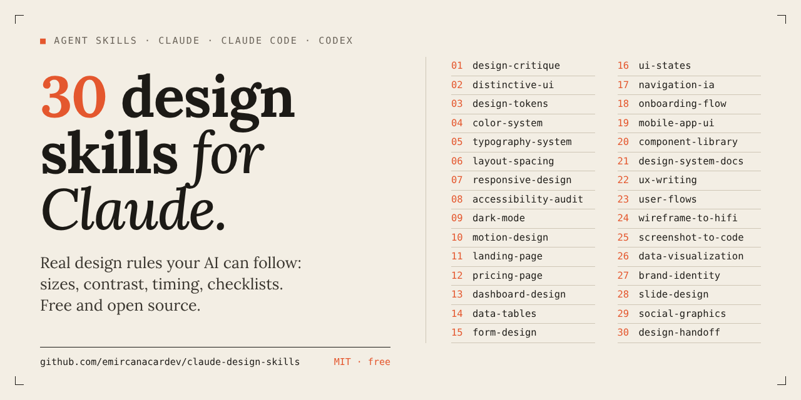

# Claude Design Skills



[](#whats-inside)
[](#install)
[](LICENSE)

**30 free design skills for Claude, Claude Code and Codex.** Each one teaches the AI a real design workflow with concrete rules: real sizes, contrast values, timings, checklists. Ask "make this landing page less generic" or "audit this form" and it knows what good looks like.

<h2 align="center">⭐ If these skills help you, please star the repo ⭐</h2>
<p align="center">It helps other people find it, and it tells me to keep adding more.</p>

Made by [Emircan Açar](https://github.com/emircanacardev). I also make animated shorts about AI as [@agentpoly](https://www.instagram.com/agentpoly) on Instagram.

---

## What's inside

### Foundations
| Skill | What it does |
|---|---|
| `design-critique` | Structured critique of a screenshot, URL or UI code, with prioritized fixes (P0/P1/P2) and exact values |
| `distinctive-ui` | Gets rid of the generic "AI-made" look: one aesthetic direction, characterful type, one bold accent |
| `design-tokens` | Primitive → semantic → component tokens, exported as CSS variables, W3C DTCG JSON and a Tailwind theme |
| `color-system` | OKLCH color ramps 50–950, tinted neutrals, semantic colors and contrast-checked pairs for light and dark |
| `typography-system` | Type scale, font pairing, line heights, 45–75ch measure, fluid `clamp()` sizes, font loading |
| `layout-spacing` | 4/8-point spacing, grouping, a 12-column grid, container widths, section rhythm |
| `responsive-design` | Mobile-first layouts from 320px to wide screens, container queries, responsive images |
| `accessibility-audit` | WCAG 2.2 AA audit with an issue table and fixed code |
| `dark-mode` | Real dark themes: elevation, desaturated colors, token swaps, no flash on load |
| `motion-design` | Microinteractions and transitions: durations, easing, stagger, reduced motion |

### Product UI
| Skill | What it does |
|---|---|
| `landing-page` | One audience, one action: section order, headline, CTA hierarchy, fast loading, built as code |
| `pricing-page` | 2–4 tiers, a recommended plan, an honest monthly/annual toggle, a comparison table |
| `dashboard-design` | Dashboards that answer questions: KPI cards, layout by importance, filters, drill-down |
| `data-tables` | Tables people can scan: alignment, sticky headers, sorting, bulk actions, responsive strategies |
| `form-design` | Forms people finish: labels, autocomplete, validation timing, accessible errors, multi-step |
| `ui-states` | Empty, loading, error, success, offline and permission states, with copy and code |
| `navigation-ia` | Information architecture and navigation patterns, labels, URLs, mobile nav |
| `onboarding-flow` | First-run flows that reach the activation moment fast |
| `mobile-app-ui` | Native-feeling iOS and Android UI: safe areas, touch targets, sheets, gestures |
| `component-library` | Reusable, accessible components with clean APIs and a full state matrix |

### Craft and delivery
| Skill | What it does |
|---|---|
| `design-system-docs` | Component documentation pages: anatomy, variants, do/don't, accessibility, props |
| `ux-writing` | Button labels, error messages, empty states and confirmations, as a before/after table |
| `user-flows` | User flows as Mermaid diagrams, with edge cases, a screen inventory and fewer steps |
| `wireframe-to-hifi` | Sketch, wireframe or whiteboard photo → high-fidelity UI |
| `screenshot-to-code` | Rebuilds a UI you own from a screenshot as clean, responsive code, then compares the result |
| `data-visualization` | The right chart for the question, direct labels, colorblind-safe palettes, takeaway titles |
| `brand-identity` | Positioning, personality, voice, logo brief and a one-page brand guide |
| `slide-design` | Decks with one idea per slide and assertion titles, at 1920×1080 |
| `social-graphics` | Posts, carousels, covers and thumbnails at exact platform sizes, inside the safe zones |
| `design-handoff` | Developer handoff: specs, states, breakpoints, motion, accessibility notes, acceptance criteria |

---

## Install

### Claude Code: as a plugin (easiest, updates with one command)
Inside Claude Code:
```
/plugin marketplace add emircanacardev/claude-design-skills
/plugin install design-skills@agent-poly
```
Skills then appear as `/design-skills:landing-page`, `/design-skills:design-critique` and so on. Claude also picks them up on its own when your request matches.

### Claude Code: copy the folders
```bash
git clone https://github.com/emircanacardev/claude-design-skills
cd claude-design-skills
./install.sh              # macOS / Linux → ~/.claude/skills
powershell -ExecutionPolicy Bypass -File .\install.ps1   # Windows
```
For a single project, copy only the skills you want into `your-project/.claude/skills/`.

### Claude app (claude.ai, desktop)
1. Open **Settings → Capabilities** and turn on **code execution and file creation**.
2. In the **Skills** section, click **Upload skill** and pick a zip from the [`zips/`](zips) folder. Upload one zip per skill and choose only the ones you need.

Custom skills need a paid plan (Pro, Max, Team or Enterprise).

### Codex
```bash
./install.sh --codex      # → ~/.agents/skills
./install.sh --both       # Claude Code and Codex
```
Or put the skill folders in `.agents/skills/` inside a repository.

---

## Use them
Just ask in plain words:
- "This dashboard looks like every other SaaS. Make it distinctive."
- "Audit this signup form for accessibility and fix it."
- "Turn this whiteboard photo into a real UI."
- "Design a pricing page with three plans and an annual toggle."
- "Make an Instagram carousel about our launch."

Skills work well in pairs: `distinctive-ui` + `landing-page`, `color-system` + `dark-mode`, `design-critique` + `accessibility-audit`.

## Make them yours
Every skill is a single readable `SKILL.md`. Change the rules to match your own design system: your fonts, your spacing scale, your brand colors.

## Contributing
Found a rule that is wrong or missing? Open an issue or a pull request. Each skill is one `SKILL.md`, so changes are easy to review.

## License
MIT. Use them, fork them, share them. A star or a mention is appreciated.
