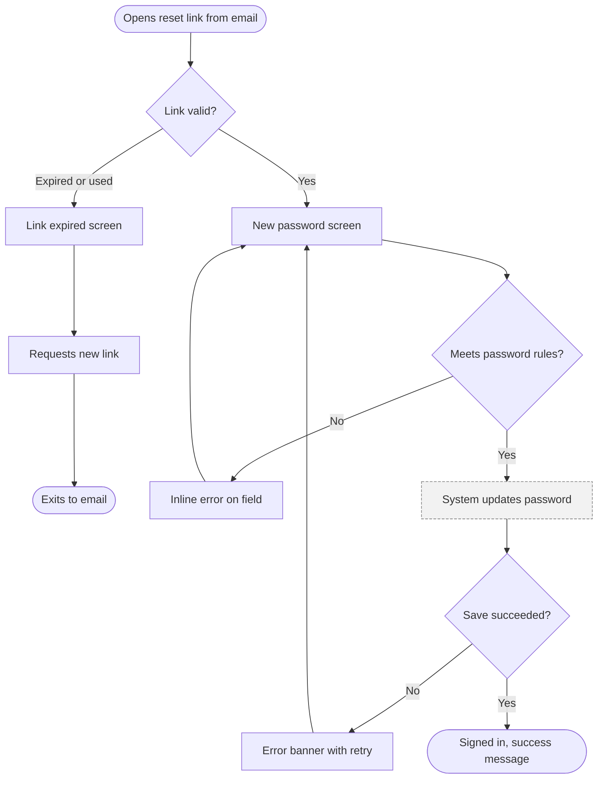

# User Flows

Produces a complete map of how a user reaches one goal: a Mermaid flowchart with every branch, a screen inventory, a before/after step count, and the open questions the team must answer.

## When to use
- "Map the checkout / sign-up / password reset flow."
- Planning screens before wireframing a new feature.
- Finding why a task feels long or where users get stuck.
- Making sure error, empty, and permission cases are designed, not just the happy path.
- Aligning product, design, and engineering on what the system does at each step.

## Workflow
1. Define the flow in one line: user type, goal, success state ("Returning customer reorders a past purchase; ends on order confirmation"). If the goal is unclear, ask one question; otherwise state the assumption.
2. List entry points (direct URL, email link, push notification, search, in-app button, deep link) and the state the user arrives in (signed in or out, first visit, mid-task).
3. Write the happy path as numbered steps, each a single user action or system response. Count the user steps.
4. Add decision points as diamonds: system checks (valid? authorized? in stock?) and user choices. Label every outgoing edge.
5. Add edge cases and error branches: validation failure, network error or timeout, permission denied, empty data, duplicate, expired session or link, payment failure, abandonment and resume.
6. Mark exits: success, cancel, handoff to another flow, and explained failure. Every error branch must lead to a recovery or an explained exit.
7. Cut steps: for each step ask whether it can be removed, merged, prefilled, defaulted, deferred until needed, or done by the system. Report the user step count before and after.
8. Derive the screen inventory and the open questions.

## Rules
- One flow = one user goal. Split separate goals into separate diagrams and reference them by name.
- Shapes: stadium `([ ])` for start and end, rectangle `[ ]` for screens and steps, diamond `{ }` for decisions, cylinder `[( )]` for data stores or external services.
- Distinguish user actions from system actions with a `classDef` style, and say which is which in a legend line.
- Every decision has all outcomes labeled with `-->|Label|`; no unlabeled branches.
- Keep each diagram under about 25 nodes; collapse a sub-flow into one node and draw it separately.
- Use `flowchart TD` for branching flows and `flowchart LR` for short linear wizards.
- Use the same IDs and names for screens in the diagram and in the inventory.
- Mark steps that require sign-in, payment, or permissions; each one creates new branches.
- Note where state must persist (draft, cart, form progress) when the user leaves and returns.
- Assume users can land mid-flow from deep links and notifications, not only at step 1.

## Output
1. Summary: user, goal, entry points, success criteria, user steps before and after optimization.
2. Mermaid flowchart, for example:

3. Screen inventory: | ID | Screen | Purpose | Entered from | States needed (loading, empty, error, success) |
4. Edge cases: | Case | Where it occurs | Designed response |
5. Open questions (business rules, limits, timeouts, copy) with an owner where known.

## Avoid
- Happy-path-only diagrams.
- Several goals tangled into one sprawling chart.
- Unlabeled decision branches and errors that dead-end.
- Visual details (colors, button styles) instead of steps and decisions.
- Steps added for business convenience (extra confirmations, forced account creation before value) without a stated reason.
- Mermaid syntax that does not render: duplicate IDs, unbalanced brackets, reserved words such as `end` used as an ID.

## Final check
- [ ] Goal, user, entry points, and success state are stated.
- [ ] The Mermaid code renders and every decision edge is labeled.
- [ ] Every error has a recovery path or an explained exit.
- [ ] User steps are counted before and after cuts, with each cut explained.
- [ ] Screen inventory matches diagram names and lists required states (see ui-states).
- [ ] Assumptions appear as open questions; screens are ready for wireframe-to-hifi.
